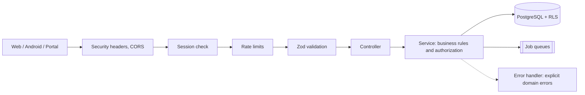

# RobMart Backend — Engineering Overview

RobMart is a home-care operations platform, built and run by a single developer. It coordinates caregivers and
patients: assignments and rate agreements, shift scheduling and shift lifecycle, a clinical log (vital signs,
medication schedules and administration), worker balances and settlements, electronic invoicing with Argentina's
tax authority (ARCA), and a read-only portal for the client who contracts the care.

RobMart is an intranet-style platform, not a public product: access is limited to provisioned users. The backend
is in production and serves the web app (which includes that portal) and a native Android app. The Android app is
in a limited A/B pilot, distributed directly to designated users rather than through Google Play.

This repository is a **public summary** of the backend. The production source is private. Nothing here is code,
infrastructure detail, credentials, or customer or patient data.

## Stack

| Area | Choice |
|---|---|
| Runtime | Node.js 24, TypeScript (ESM, strict) |
| HTTP | Express 5, Zod 4 validation at every boundary, OpenAPI contract |
| Data | PostgreSQL with row-level security, Prisma 7 |
| Jobs | BullMQ on Valkey: invoicing, PDF rendering, notifications, scheduled maintenance |
| Realtime | Server-Sent Events over Redis pub/sub, Web Push and FCM |
| Storage | S3-compatible object storage behind short-lived presigned URLs |
| Tests | Vitest + Supertest integration tests against a real PostgreSQL |

## Architecture

- **Layered:** routes declare the contract and validation; controllers only orchestrate; services own the business
  rules and either return data or throw an explicit domain error with its HTTP status.
- **Two authorization layers:** every service checks the caller's role and ownership, and the database enforces
  row-level security on top, with the authenticated user and role injected per request. The goal is that a bug in
  one layer is not enough to expose another user's rows.
- **Background work:** invoicing, PDF generation and notifications run in queues with retries, a dead-letter
  ledger and reconciliation jobs, so a failed external call is retried or recorded instead of silently lost.

## Security model

- **Sessions:** JWT in an `httpOnly` cookie, checked against a server-side session allowlist. Logging out revokes
  that session; changing the password or disabling MFA revokes every other session of the user.
- **Login hardening:** CAPTCHA after repeated failed attempts per account and network, plus rate limits on login,
  MFA and passkey endpoints.
- **MFA:** opt-in TOTP with one-time recovery codes, and passkeys (WebAuthn) as a passwordless option.
- **Data at rest:** fiscal credentials and MFA secrets are encrypted at the application layer; recovery codes are
  stored hashed.
- **Documents:** uploads and downloads go straight to object storage through short-lived presigned URLs.
- **Audit and retention:** append-only audit log for sensitive actions, including client-portal reads; location
  data is purged after 90 days.
- **Supply chain and CI:** dependency audit and a CycloneDX SBOM on every run, a migration guard, and a job that
  applies the real migrations and checks the RLS catalog and deny-by-default behavior, so a model without RLS
  coverage fails the build.

Vulnerability reports: see [SECURITY.md](SECURITY.md).

## Engineering practice

- **Scale of the codebase:** 64 data models, 108 versioned migrations, 32 route modules, 155 integration test
  files.
- **Migrations are append-only:** once applied, a migration is never edited. RLS policies, checks and partial
  indexes go in reviewed SQL migrations.
- **CI gates:** type checks, generated OpenAPI with linting and contract tests, a coverage threshold, the
  integration suite on real PostgreSQL and Valkey, and the RLS guard. Deployment only happens after all of them
  pass.
- **Readiness:** health checks report liveness and readiness separately, and shutdown drains HTTP, jobs, streams
  and connections in order.

## Representative business rules

- A caregiver cannot start a shift while another one is active, and closing a shift is restricted by role.
- Pay is computed from the assignment's rate agreement plus special conditions, such as holidays.
- Medication schedules generate expected doses, and a missed dose raises an alert.
- Retried writes are idempotent, so a flaky connection does not duplicate patient memories or contacts.

## Public scope

This summary leaves out source code, infrastructure topology, secrets, internal controls, and any real patient or
client data. The design choices above are described only at the level needed to show the approach.
