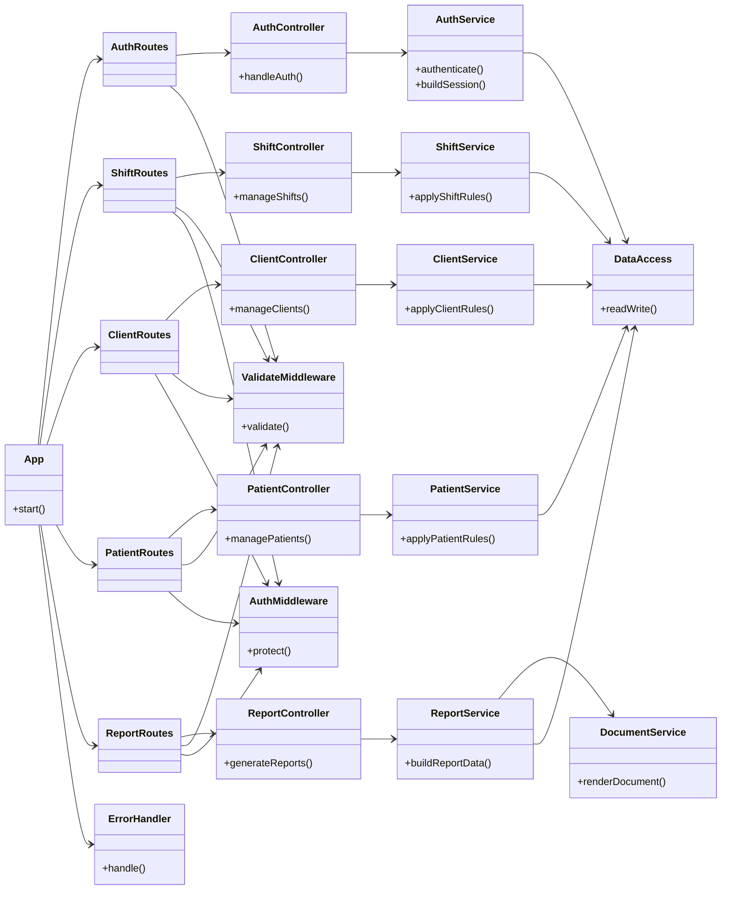
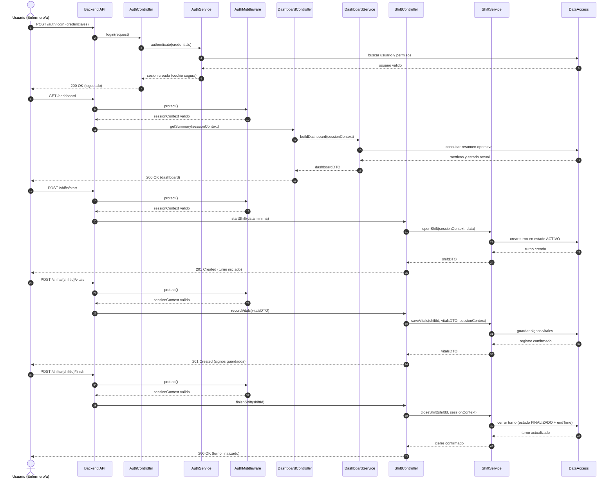

# RobMart-Backend - Production Engineering Snapshot

Backend API for a production home-care workflow. This repository is a public-facing summary of the work delivered: authentication, worker-patient assignments, shift lifecycle, clinical records, and operational reporting.

## What this backend solves
- Secure access for operational users with role-based authorization.
- Assignment and rate agreement management between workers and patients.
- Shift lifecycle handling (start, close, payment status).
- Clinical support tracking (vital signs and medication events).
- Operational visibility through reporting/dashboard endpoints.

## My engineering contribution
- Designed and implemented a layered API architecture (routes -> controllers -> services -> data).
- Established validation-first contracts with Zod across boundary inputs.
- Centralized domain error handling with explicit and predictable HTTP mapping.
- Implemented secure middleware baseline: Helmet, CORS policy, rate limits, cookie-based JWT.
- Delivered schema evolution through Prisma migrations and integration-focused tests.

## Key technical decisions
- Cookie-based JWT transport to reduce frontend token exposure.
- Business rules isolated in services to keep controllers thin and testable.
- Explicit domain errors (AppError pattern) to improve observability and debugging.
- Prisma as the ORM boundary to keep data access consistent and maintainable.

## Representative business complexity
- Prevent starting a new shift while another active shift exists.
- Restrict shift closing permissions by role.
- Compute compensation from assignment rate plus special conditions (for example, holiday multiplier).
- Keep shift, notes, and clinical records coherent across the workflow.

## Quality and production readiness
- TypeScript + Express 5 + PostgreSQL + Prisma ORM.
- Zod-based request validation and standardized API error shape.
- Integration testing with Vitest + Supertest.
- Versioned database changes via Prisma migrations.
- OpenAPI/Swagger documentation for endpoint contracts.

## Public scope note
This repository intentionally excludes secrets, infrastructure-sensitive details, and any real patient/client data.

## Architecture diagrams (representative)
The following diagrams are intentionally simplified to show engineering approach without exposing sensitive implementation details.

Security note: diagrams omit infrastructure topology, secrets, internal controls, and any sensitive operational metadata by design.